# What's new

## Taxi to runway

A ground aircraft's Taxi to runway, in the quick-command strip or under All Commands, opens one flyout with a tab for every runway end of the airport: the aircraft's assigned runway ("30 assigned"), the room's departure runways ("28L departure"), then the rest by runway number. The assigned and departure runways are searched as the flyout opens; any other runway is searched the first time you choose its tab, and its tabs show a spinner until the entries appear. A tab whose search failed tries again only when you click it or press Enter on it.

A runway end with no entry is dimmed with "none".

Each tab lists the runway end's entries: the full-length entry, then each intersection long enough for the aircraft's type, with the runway left, the taxi distance and the route, and under each its For departure and Hold short of runway variants, the whole command shown rather than cut. Preset taxi routes that end at the runway sit beside them. Pointing at a row, or moving to it with the arrow keys, previews its route; Left and Right change tab.

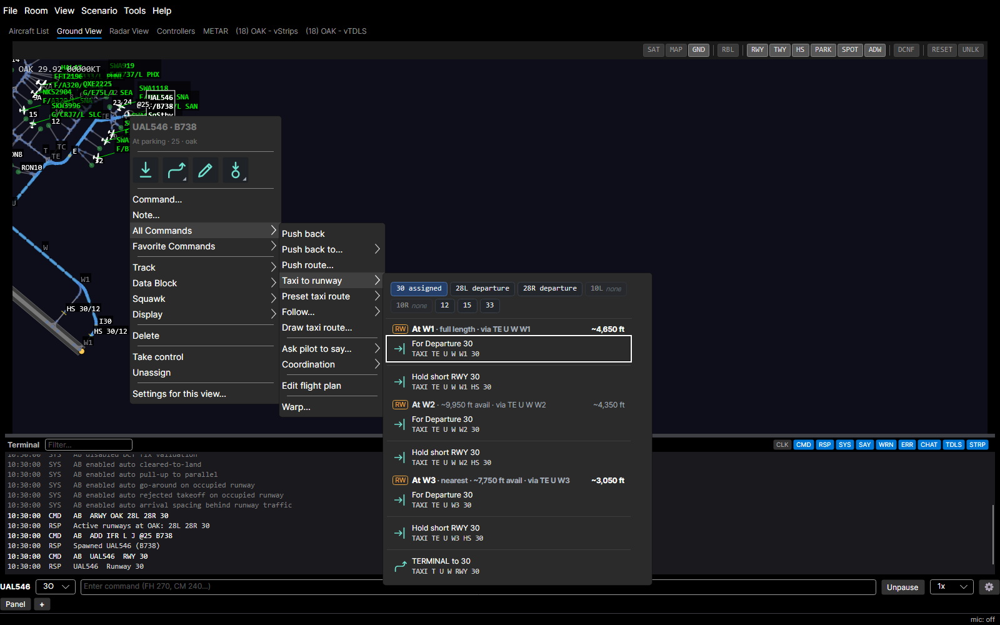

## Ground flyouts

Give way to… and Follow… list the nearby ground traffic, nearest first with a moving ▶ or parked ■ mark, refreshed each second; Follow adds a filter box, and an empty list says why. Pointing at a row previews both routes on the ground view, rings where they meet, and highlights that aircraft on the radar.

Hold short of… opens a ladder of the bars on the aircraft's route, nearest first; pointing at a stop boxes its bar and previews the route there. Preset taxi route lists the airport's presets nearest first, each with its taxiways, distance and command, and pointing previews the route.

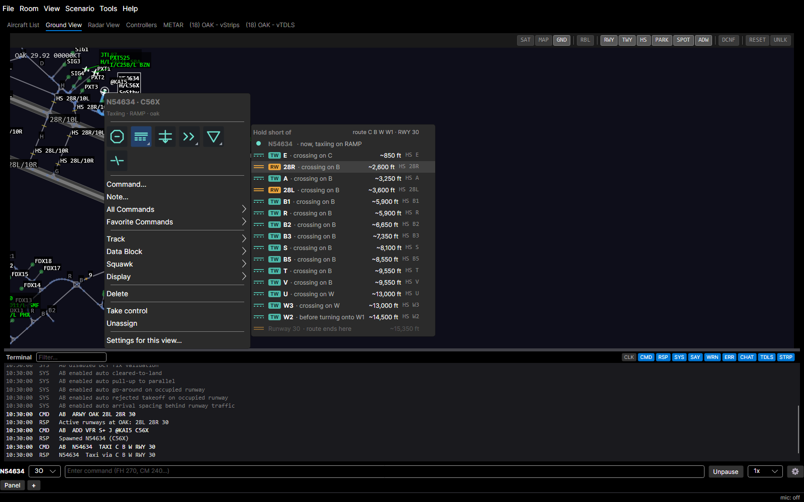

Exit left and Exit right list the exits ahead with their distance and turn-off angle; on final, an Exit at box suggests the runway's exits. On the ground view, a point menu's Taxi here and Taxi to runway list routes with their distance and the runways they cross, the targets nearest the click first.

## Helicopter air taxi and landing

A helicopter's quick-command strip offers Air taxi on the ground and Land in the air. Each opens a flyout with an "Air taxi to" or "Land at" filter box over tabs of destinations: Pads · parking, Spots and, for Air taxi, Runways (the holding positions). Land has a Keep NODEL box. A row sends `ATXI` or `LAND`, and `LAND $spot` sets a helicopter down on a taxiway spot and holds it there.

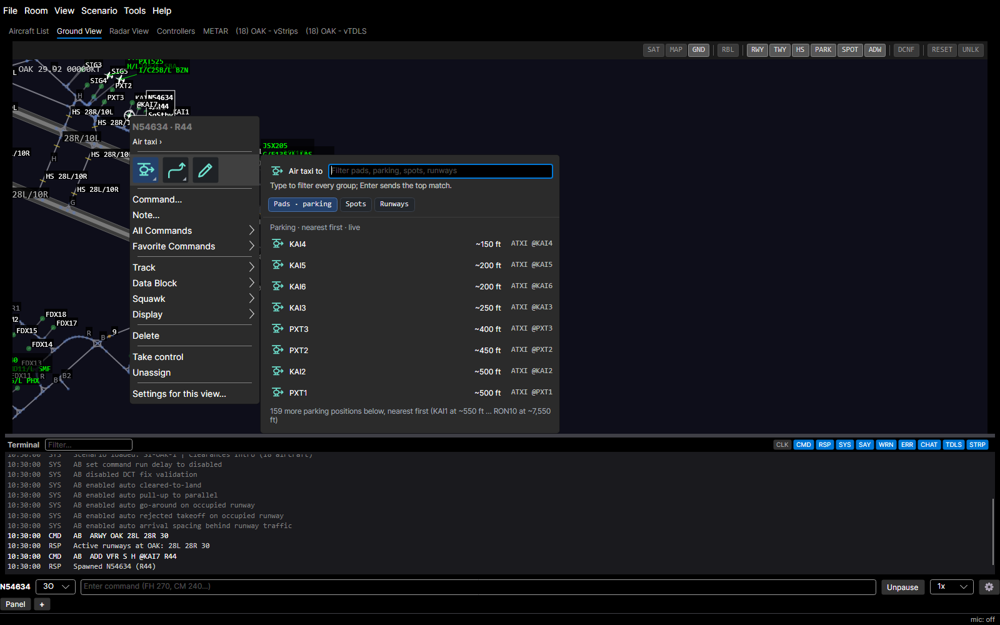

## Approach clearances

Every approach command (Cleared approach, Expect approach, Join approach, the straight-in and forced forms, and Join final course), in the quick-command strip or under All Commands › Approach, opens one flyout with a tab for every runway of the destination, the room's arrival runways first and a Circling tab last. The default approach (the expected one, else the assigned runway's ILS) is pinned above the tabs with focus on it, so Enter sends it.

Each tab starts with a Visual row, greyed "field not in sight" until the field is reported, and a runway too short for the aircraft's type is dimmed "short". At an untowered airport a "Visual approach to" row clears the aircraft to the airport, as `CVA {airport}` does from the command line, where the pilot picks the landing runway by wind and reads it back. `EAPP VIS28R` tells the pilot to expect a visual, and a later bare `CAPP` clears it. Outside solo training, the Force toggle in Cleared approach turns every row into its forced form; an Approach box takes an id and sends the top match on Enter; and an IFR aircraft airborne below FL180 gets a "Cancel IFR…" row with an inline confirmation.

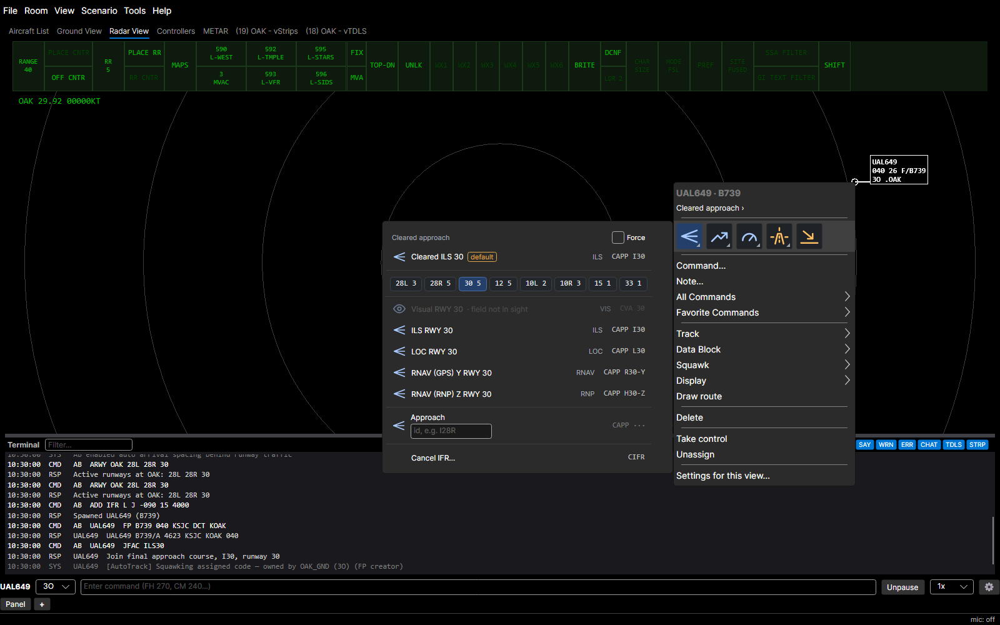

## Fly heading

Fly heading in the quick-command strip, and Fly heading, Turn left, Turn right and the two degree turns under All Commands › Heading, open one flyout instead of a list of 72 headings. It has a toggle between Fly heading, Turn left and Turn right (the turn entries open it on their verb), a Heading box that also takes `L180` or `R090`, a Present heading row on top that sends `FPH`, and a north-up compass rose with its needle on the aircraft's heading, between columns of 5° to 90° chips for a turn left or right by that much.

Click the rose, or drag across it and release, to send that heading; the readout names the heading, the turn it makes and the command (`300 · a right turn of 30° · FH 300`). The arrow keys step the rose by 5°, 30° with Shift, and Enter sends. The needle, the present heading and the chip tooltips follow the aircraft once a second.

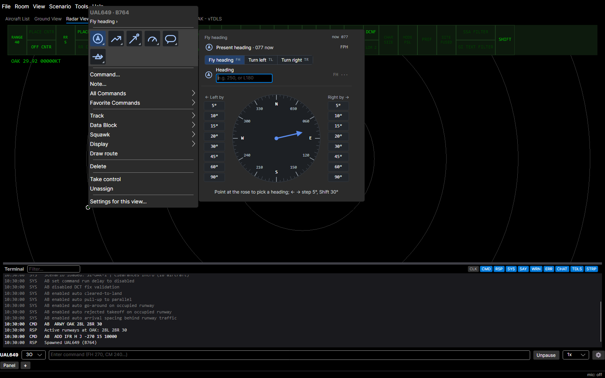

## Maintain altitude

Maintain altitude, in the quick-command strip and under All Commands › Altitude, opens a flyout instead of a popup. The Altitude box has focus: type `230` or `23000` and the nearest row is outlined and the box shows the command it would send. Below it a list, at most 300 px tall, opens centred on the assigned altitude, else the current one; each row shows its mark (● now, ◆ assigned, ↑ climb, ↓ descend), the altitude and the command, with the MVA line among the rows and the altitudes under it greyed "below MVA" (they still send).

Down from the box goes to the current altitude's row, Up and Down walk the rows, Enter sends and Escape goes back to the strip. The marks, the verbs, the MVA line and the "now" altitude follow the aircraft once a second while the rows stay put. Temporary altitude… and Cruise…, under All Commands › Data Block, open a one-box flyout too, previewing `TEMPALT 120` or `CRUISE 240`, or "Not a valid altitude" when the text cannot be read.

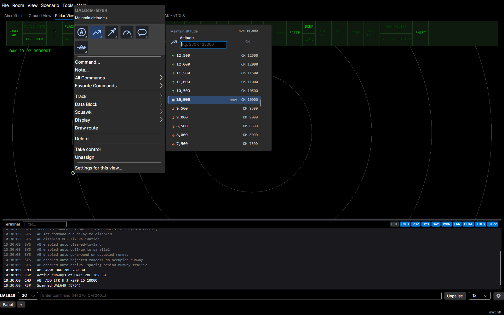

## Assign speed

Assign speed, in the quick-command strip and under All Commands › Speed (with Speed…), opens a flyout instead of a list or an input popup. The Speed box has focus: type `250` and its readout shows the command it would send, `SPD 250`, or "Not a valid speed". Below it are Resume normal speed and Final approach speed (with the type's approach speed), then a Knots grid of chips eight to a row, and at or above FL240 a Mach grid (`M.78` sends `MACH .78`).

The present speed and Mach chips are filled, the assigned speed's chip and the chip the box names are outlined, and a chip's tooltip is its command. Down from the box walks Resume normal speed, Final approach speed and the grids, the arrow keys move within a grid, Enter sends and Escape goes back to the strip. The title and the marks follow the aircraft once a second.

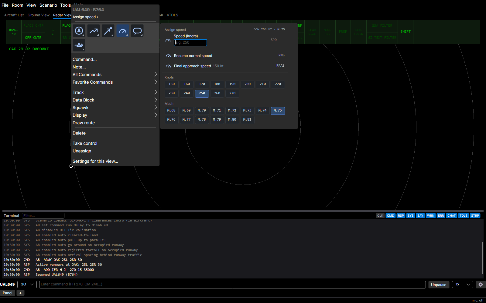

## Direct to

Direct to… and Append direct to…, in the quick-command strip and under All Commands › Navigation, open one flyout instead of a list or an input popup. The title says which verb it is, with "→ {next fix}" while the aircraft navigates to a fix, and then a toggle switches between Direct to (`DCT`) and Append to route (`ADCT`). The Fix box has focus, takes a fix name or an FRD, shows the command Enter would send, and says "Not a known fix" in red when it can send nothing.

Below it, "Remaining route" lists the fixes ahead with a ● on the next one, each with its distance and magnetic bearing from the aircraft (`31 NM · 184°`, the heading it would fly) and its command; a fix the aircraft has passed greys to "passed" for as long as the flyout stays open but still sends. Type a few letters and the route rows narrow and "All fixes · nearest first" lists the 50 nearest other fixes starting with them, however far; an FRD such as `RBL184031` gets its own row. The first row is outlined and Enter sends it. Down moves from the box into the rows, Up walks back to it, and Enter sends the focused row. The rows follow the aircraft once a second and stay put.

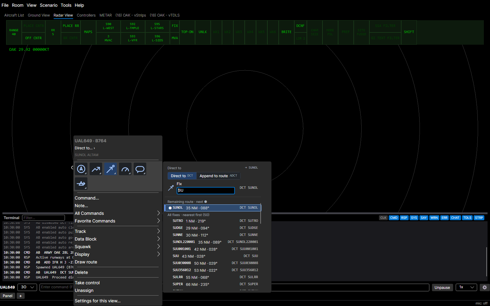

## Cross fix and Depart fix

Cross fix and Depart fix, in the quick-command strip and under All Commands › Procedures, open a flyout instead of a route-fix list and an "(other)…" box, and the menu no longer sends a bare `CFIX SUNOL` or `DEPART SUNOL`.

The Fix box takes a fix name and the boxes under it take what the command needs. Cross fix has a "Cross at" toggle (At, At or above, At or below), an Altitude box (`230` or `23000`) and an optional Speed box in 5-knot steps, and a caption such as "Cross SUNOL at or above 11,000 at 250 knots" for `CFIX SUNOL A110 250`. Depart fix has a "Heading after the fix" box and sends `DEPART SUNOL 200`.

Below the boxes, "Route" lists the aircraft's fixes with a ● on the next one, each with its distance and magnetic bearing, and typing adds the nearest other fixes starting with your text. Every row shows the whole command it would send, ending `···` while the altitude or heading is missing. Clicking a row, or pressing Enter, with a value missing sends nothing: it fills the Fix box and moves to the box that is missing, which says in red what it needs.

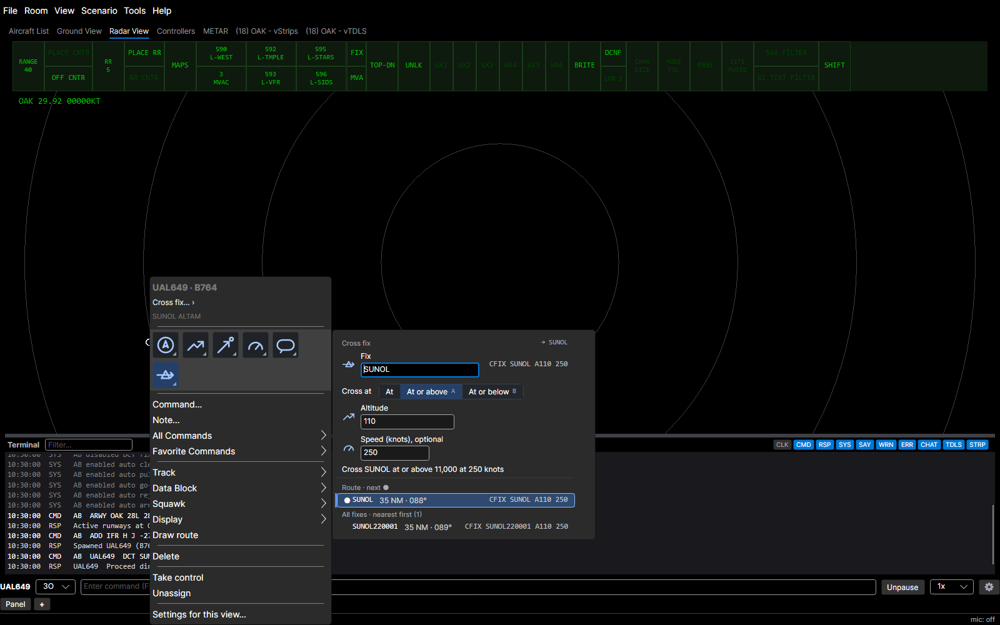

## Join airway and Join radial

Join airway opens an Airway box over the filed airways (marked ◆), then the airways nearby. Each row names the fix the aircraft joins after intercepting on its present heading, with that fix's distance and bearing, and Enter sends `JAWY V25`.

Join radial outbound and inbound share one flyout with an Outbound / Inbound toggle, a Fix box that takes a VOR, VORTAC or TACAN, the nearby navaids with the radial the aircraft is on now, a radial box and a compass rose. Radials now use the navaid's published magnetic variation.

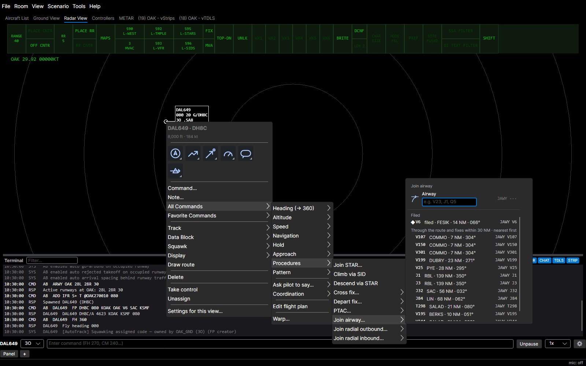

## Hold at fix

Hold at fix…, in the quick-command strip and as the first entry of All Commands › Hold for an airborne IFR aircraft, opens a flyout instead of a free-text box. Under the Fix box it has an "Inbound course" box (empty sends the default course), the Legs chips (1 min, 1½ min, 5 NM, 10 NM, opening on 1½ min above 14,000 ft) and a Right or Left toggle, with a caption such as "Hold north of SUNOL on the 184 course inbound" and the whole `HOLDP SUNOL 184 1M R` on every row.

With the course empty, a fix further along the route is held on the leg from the fix before it, and any other fix on the course arriving from the aircraft, magnetic and following the aircraft each second; at a VOR the radial shows beside the course. The old Hold at fix (left) and (right) entries under All Commands › Hold are now "Left 360s at fix…" and "Right 360s at fix…", which open a flyout with a Left 360s / Right 360s toggle, are offered to VFR aircraft aloft too, and still send `HFIXL` and `HFIXR`.

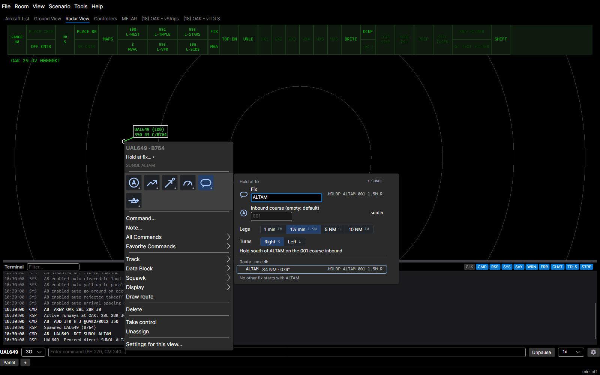

## PTAC

PTAC… under All Commands › Procedures opens a flyout too: a PTAC / Forced toggle, Heading and Altitude boxes (empty sends the present value, `PH` or `PA`) and the destination's approaches, each row showing the whole command such as `PTAC 280 025 I28R`. "The expected approach" row sends no approach id.

## Handoff and point out

Initiate handoff… and Point out…, under Track, open a flyout instead of a "Position ID" popup. Type a TCP, sector, callsign or frequency to filter the staffed positions, listed as code, name and frequency under their facility (yours first, then Towers, the Center and the rest), with your own position on top; Enter sends `HO` or `PO` for the outlined row.

The track's owner is greyed as "owns the track", Point out lists only positions with a STARS TCP, and a code that matches nothing is sent as typed. Point out has a pointing-hand icon, so it can join the quick-command strip.

## vStrips rack auto-sort

Tick Auto-sort this rack in a rack's right-click menu, or type `RACKSORT`, to keep it sorted: tail numbers, then airline callsigns, each A–Z. A banner marks a sorted rack, and a strip dropped into it settles into its sorted slot.

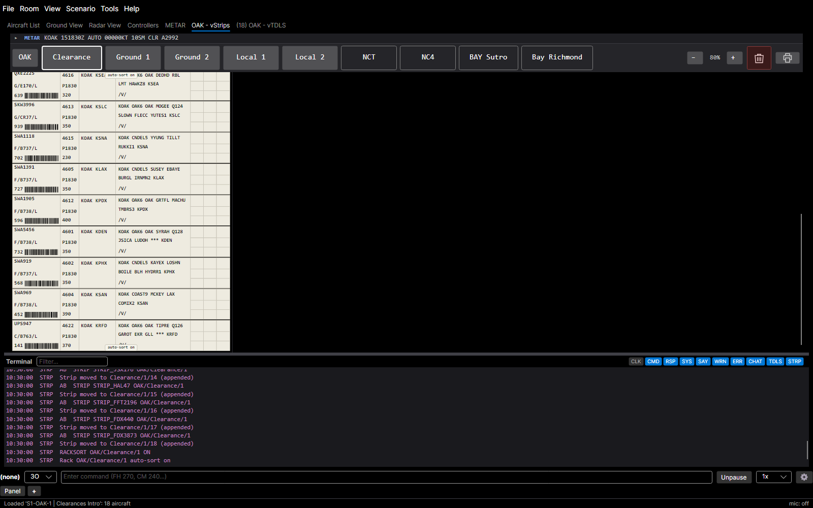

## GFS winds aloft

Load Live Weather downloads a NOAA GFS wind grid for your ARTCC, so winds aloft vary across the sector instead of being one set of layers, and the METAR window says where they came from. A second line under the weather name reads, for example, "Winds aloft: NOAA GFS 12Z 16 Oct, +4 h forecast": the forecast run and the forecast hour the grid was fetched for.

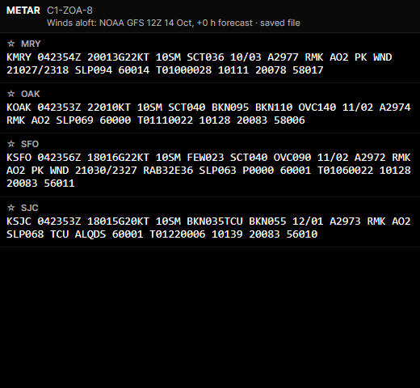

Everyone in the room sees the same line, including a client that joins later and a replay of a recording ("· recorded"). When the grid cannot be had, the line says the weather flies the FAA FD forecast (or METAR surface winds only, when it has no FD winds aloft) and, on the screen that loaded it, why. Weather saved with Save Weather As carries its grid, so loading the file brings the same winds back ("· saved file"). The status bar's load message names the source too.

## Report field in sight

Report field in sight…, in the quick-command strip and under All Commands › Approach, now opens a flyout in RPO and in solo training instead of sending a bare `RFIS`. The Field advisory box takes the clock and miles (`12 5`) with the destination named under it, and Enter sends `RFIS {clock} {miles}`; a clock dial and a Miles stepper set the same two numbers, and a grey hint, the line the pilot will hear and the field's row (name, live clock, miles and the room's arrival runways) fill the rest.

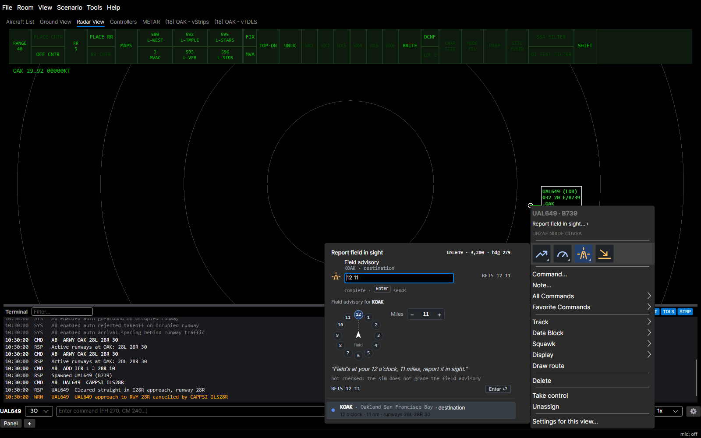

The box starts with the true values, which follow the aircraft until you edit them; in solo with "Pre-fill traffic advisories" set to "Left for the student" it starts empty and the row says to find the field on the scope. The sim records any clock and miles as the advisory, so the flyout never grades it. An aircraft with no destination field has the entry disabled. Report field in sight is a quick command for IFR aircraft holding or going around too, and gives way to Cleared visual once the pilot reports the field.

## Traffic in sight and Follow traffic

Report traffic in sight… and Follow traffic… open a flyout of the eight nearest airborne aircraft, with a Traffic box showing the command Enter sends. Pointing at a row rings that aircraft on the radar. Follow traffic… is offered to any VFR aircraft aloft and under All Commands › Approach; traffic the pilot has not reported in sight is greyed unless Force is on.

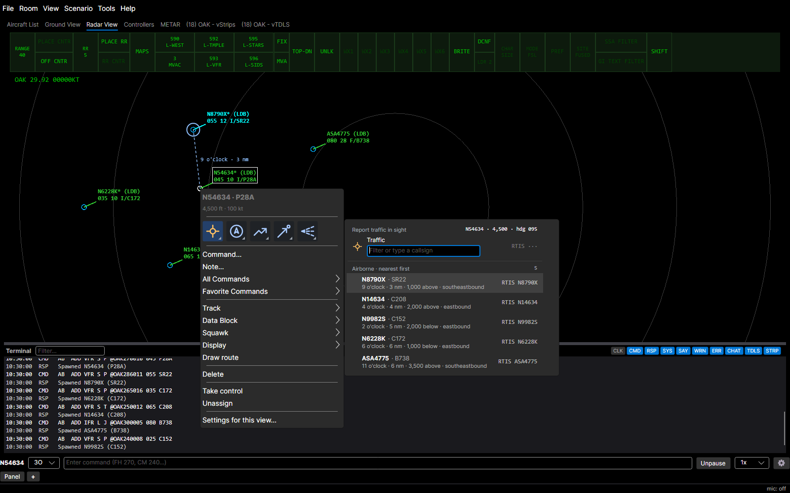

## Report traffic in sight in solo training

In a solo session, Report traffic in sight… opens a flyout where you say the advisory instead of picking a callsign: type `2 4 w sr22 35`, `base l 2 28l c152` or `over vpcol sr22` in the Advisory box, and Enter sends the structured `RTIS`. A grey hint under the box names the next part, Tab takes it from the aircraft you point at on the list, and a complete call shows the line the pilot will hear. A refusal keeps the flyout open with the sim's reply and your values.

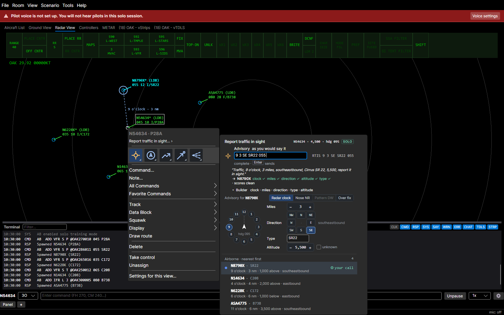

The Builder below sets the same call with a clock dial, miles stepper, direction pad, type and altitude, or a pattern or reporting-point form. The two solo settings now take effect: "Pre-fill traffic advisories" set to "Left for the student" drops the clock, miles and direction from the list rows and hides the radar bearing label, and "Live advisory check" grades the call as you type it, naming the aircraft it resolves to.
