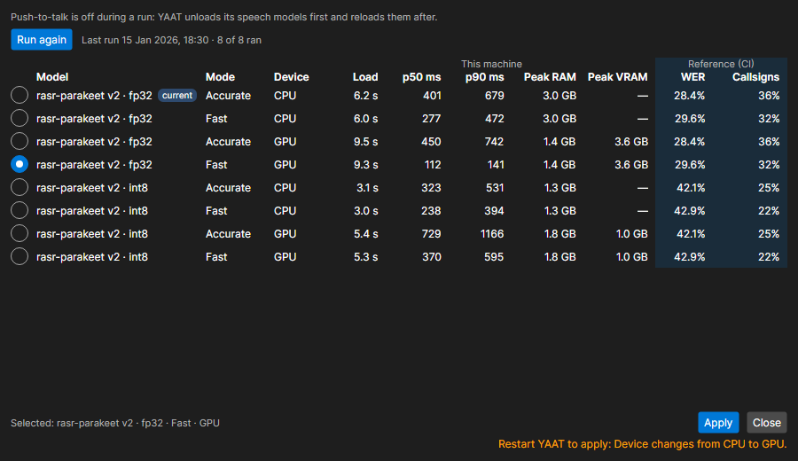

# What's new

## Pattern compression

An aircraft in closed traffic now tightens its pattern by itself when its normal circuit would cut across another runway's departure or arrival corridor: it flies the circuit at a slower pattern speed with a steeper bank, so a turboprop at Oakland 28L stays clear of runway 30. A type too fast to fit flies its normal pattern, and the instructor sees a one-time line saying which runway it crosses and the tightest pattern it can fly; in solo training the pilot says it on frequency. A pattern size given with `PS` is flown as told, down to the type's compressed floor.

## Speech recognition

Speech recognition now runs the rasr-parakeet model on sherpa-onnx by default, in place of Whisper. Pick **Fast** (the best guess, lowest latency) or **Accurate** (several hypotheses weighed against the room's callsigns, fixes and taxiways) and **CPU** or **GPU** in Settings > Speech. The model downloads from Settings > Speech, and push-to-talk is refused until it has; the GPU runtime is a separate download.

In Accurate mode a callsign the recognizer is not sure of is never staged: the status bar reads "Say again: callsign unclear", with the best guess when there is one, and the command box keeps what you said so you can correct it before pressing Enter.

Settings > Speech > **Benchmark this machine...** opens the Speech benchmark window. It runs each downloaded model in each mode on each device over short test clips and shows the load time, latency, memory and the figures YAAT measured on real radio speech beside them, so you can pick the setting that suits your machine and apply it from the window. The smaller int8 model gets noticeably more words and callsigns wrong than fp32.

