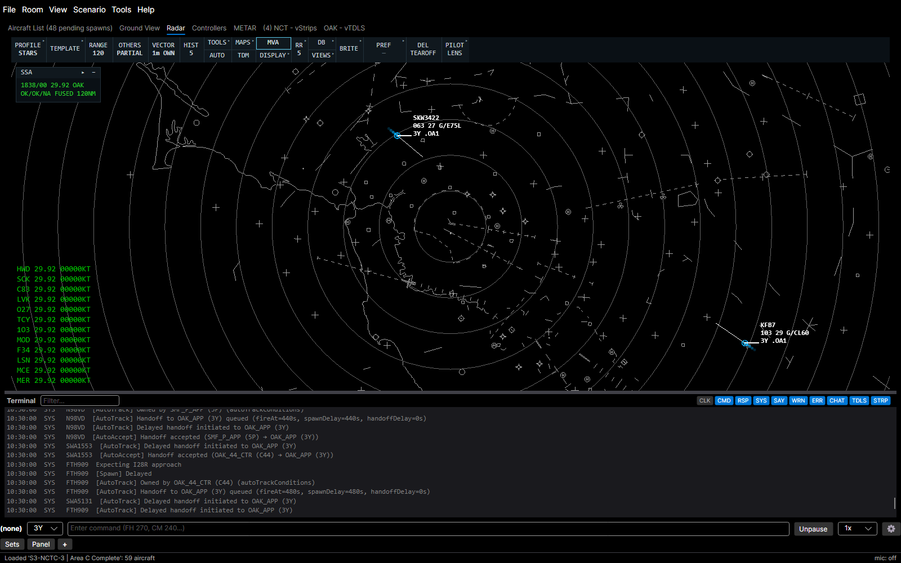
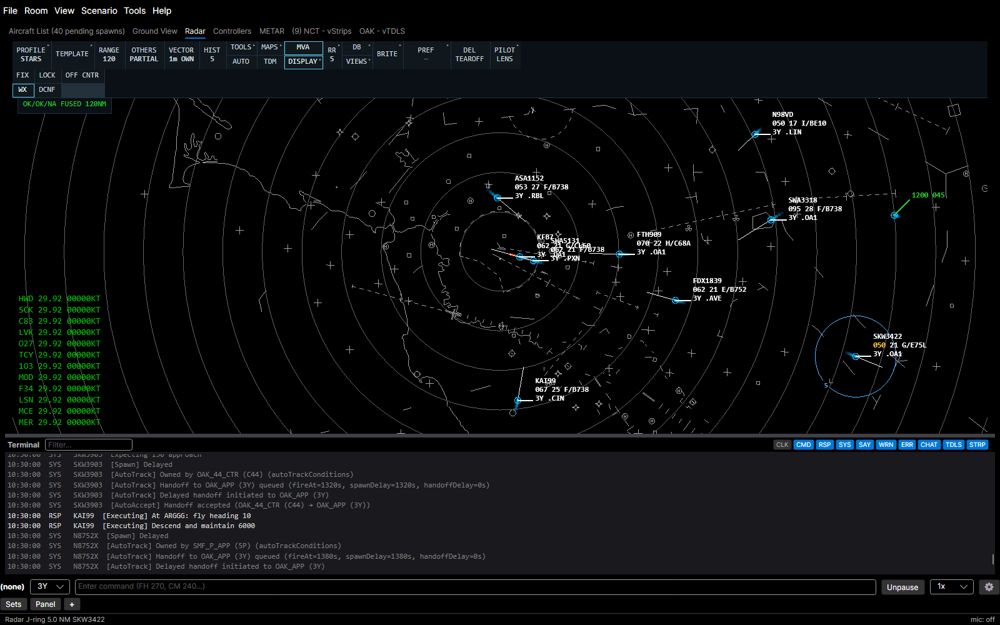
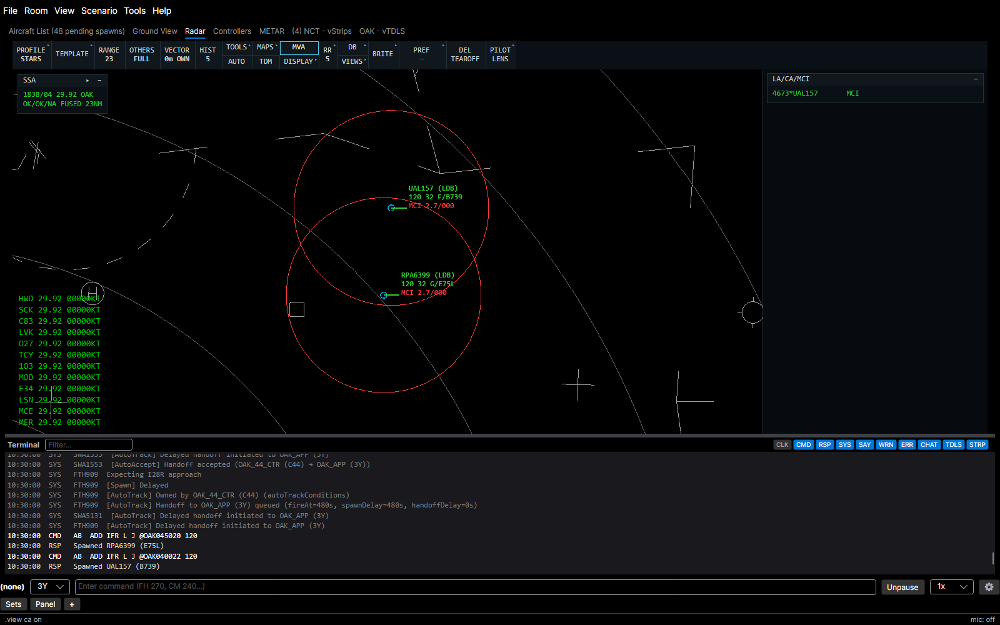
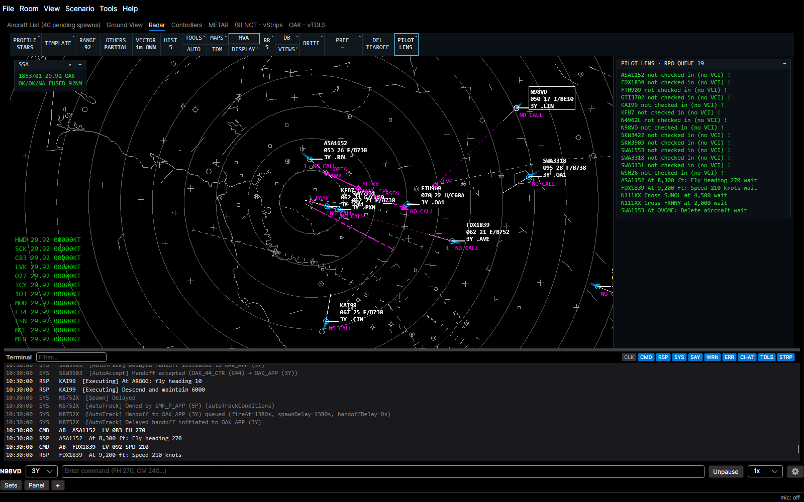
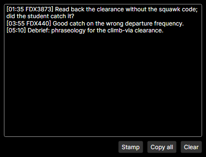

# What's new

## A new Radar

A new Radar replaces the old one in the main window's tab, its pop-out and any extra Radar windows you open. It draws the facility's video maps with STARS, ERAM or EuroScope datablocks, and each window keeps its own range, centre, maps and settings.

Click a datablock field (middle-click on ERAM) for a menu that pairs the scope entries such as QZ and QS with the matching pilot commands. Commands typed on the Radar show in the preview and feedback areas the way CRC shows them, and STARS and ERAM entries are read by CRC's own grammar. Your old Radar maps, range, centre, fixes and brightness, and the layouts and window positions you saved, carry over to the new Radar.

## The Radar toolbar

The Radar runs from a CRC STARS-style toolbar of compact tiles. Any tile can be torn off and placed on the scope, and pref sets and profiles are kept per facility, with the profile picked from the student's position. Zoom bands set how much of other controllers' traffic shows, its vector length and its history dots until you pin them, and the VECTOR and HIST tiles set them by hand.

The MVA and RR tiles turn on the MVA tint and a range ring, and the DISPLAY tray holds LOCK, OFF CNTR, the METAR (WX), chart fixes (FIX) and datablock deconfliction (DCNF). The TOOLS tray's Rings tool places J-rings, cones and DRI halos that only your Radar shows, and Ctrl+M, Alt-drag or `.rbl` draw measure lines.

## Conflict alerts on the Radar

When a conflict alert fires, the Radar keeps both aircraft's datablocks full and draws a ring around each of them (ERAM rings follow CA RING in the DB menu). The LA/CA/MCI list labels each row CA, MCI or ERAM, so you can tell at a glance which kind of alert the student sees.

A suppressed alert draws steady and dimmed and an acknowledged one steady, and an alert inhibited from the Radar marks the STARS block and says "(student display)".

## PILOT LENS and the RPO QUEUE

The PILOT LENS shows what the simulation's pilots are doing rather than what the controller's display shows. It draws an aircraft's intent path (its route, fixes and crossing restrictions, or the heading it flies), a count of the commands each pilot still has queued, and a tag on tracks whose pilot has called or has not checked in.

The RPO QUEUE view lists the calls waiting for an answer and every queued command still waiting on its trigger; click a row to select that aircraft.

## Notes

View > Bars > Notes… opens a scratch pad for your training notes, kept until you clear them. Stamp, or Ctrl+Shift+N, inserts the sim time and the selected aircraft's callsign, so each note lines up with the moment it is about, and Clear asks before it empties the pad.

