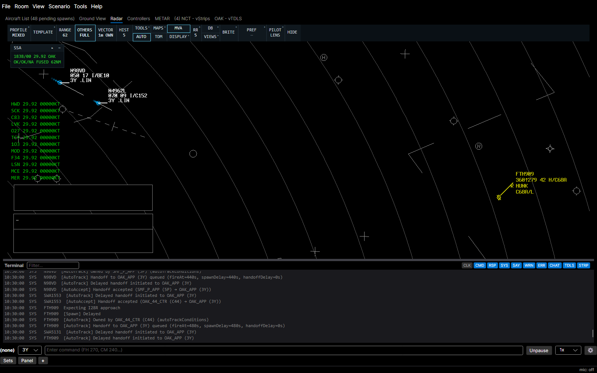
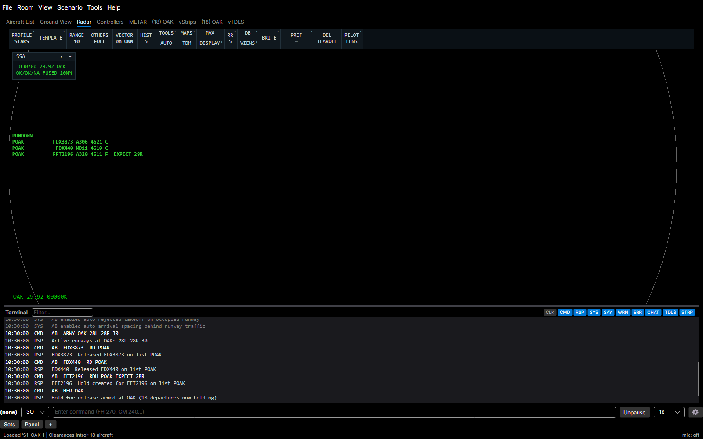
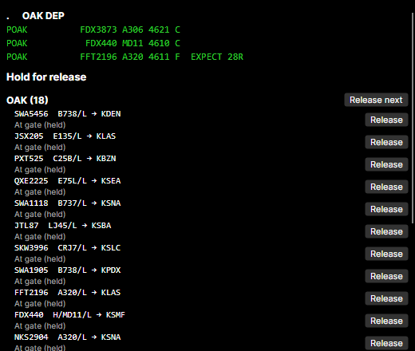
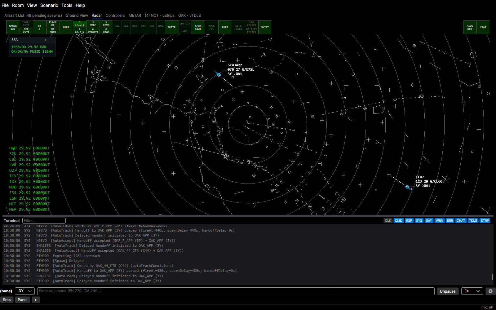
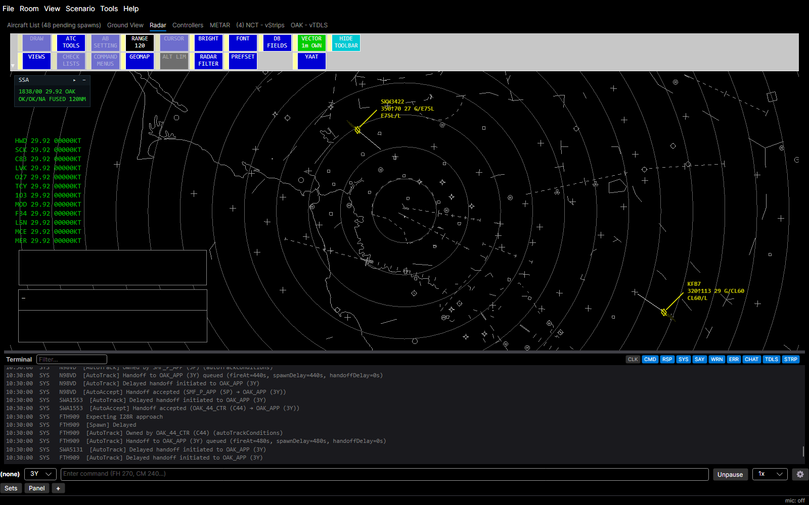
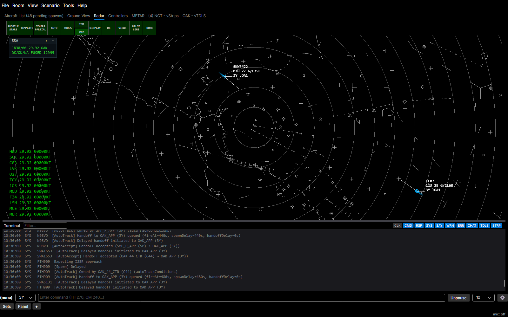
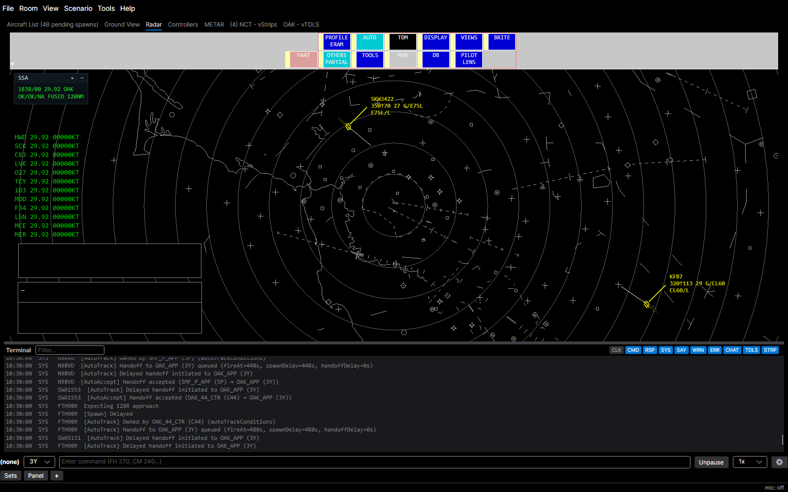

# What's new

## ERAM tracks in CRC's ERAM look

ERAM-template tracks on the Radar now draw the way CRC's ERAM display does, so in the Mixed template you can tell a center track from a TRACON one at a glance. Each target shows its own glyph by state (correlated or uncorrelated beacon, primary, ident, VFR, MCI and more), with the track-position symbol under its full datablock, history drawn as dim yellow glyphs, CRC's leader, and everything in ERAM yellow. STARS tracks are unchanged.

Settings › Appearance › Scope text picks how STARS and ERAM datablocks draw: Compact keeps the system monospace font, and Realistic draws Terminus Bold at CRC's text sizes, with its own size for STARS and for ERAM.

## Rundowns

The Radar view now draws the room's RUNDOWN list at its top-left: every STARS coordination (RD) list in one place, with CRC's coordination lines in green or yellow and countdowns that follow the simulation clock. Drag it where you like, and right-click an entry for its coordination menu: Acknowledge, Release, Recall, Hold…, Modify…, Delete, Move up and Move down.

View › Bars › Rundowns… opens a Rundowns window with the same lists, one section per list, and the same right-click menu on each row. Hold-for-release moved into it: while an airport is armed, a Hold for release section offers Release next for each field and Release for each held departure. The command bar's Releases button is gone. Layouts keep whether the window is open.

## The Radar bar follows the profile

The bar across the top of the Radar now matches the room's Radar profile. Under STARS it is CRC's STARS DCB, a black band of green bevelled tiles with its Main page, submenus and Aux page (SHIFT); under ERAM it is CRC's ERAM Master Toolbar with its menus; under Mixed it is the classic navy bar.

YAAT's own controls (profile, template, others, tools, TDM, MVA, display, DB, views and the pilot lens) are on the DCB's YAAT page and in the Master Toolbar's YAAT menu. Any bar hides to a small SHOW tile with its HIDE button or `.scope bar hide`, and `.scope bar show` brings it back. Toolbar tiles no longer tear off onto the scope; view cards still float.

