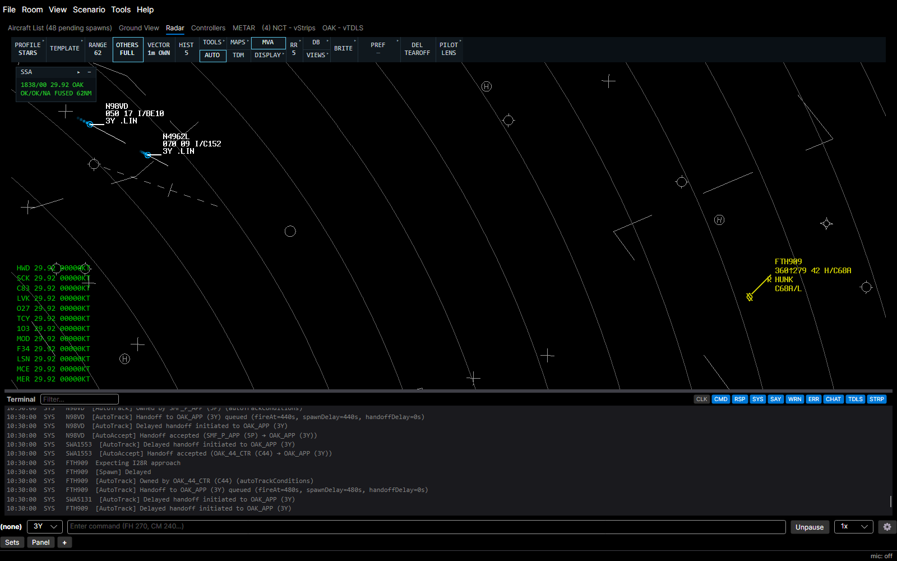

# What's new

## ERAM tracks in CRC's ERAM look

ERAM-template tracks on the Radar now draw the way CRC's ERAM display does, so in the Mixed template you can tell a center track from a TRACON one at a glance. Each target shows its own glyph by state (correlated or uncorrelated beacon, primary, ident, VFR, MCI and more), with the track-position symbol under its full datablock, history drawn as dim yellow glyphs, CRC's leader, and everything in ERAM yellow. STARS tracks are unchanged.

Settings › Appearance › Scope text picks how STARS and ERAM datablocks draw: Compact keeps the system monospace font, and Realistic draws Terminus Bold at CRC's text sizes, with its own size for STARS and for ERAM.

## Rundowns

The Radar view now draws the room's RUNDOWN list at its top-left: every STARS coordination (RD) list in one place, with CRC's coordination lines in green or yellow and countdowns that follow the simulation clock. Drag it where you like, and right-click an entry for its coordination menu: Acknowledge, Release, Recall, Hold…, Modify…, Delete, Move up and Move down.

View › Bars › Rundowns… opens a Rundowns window with the same lists, one section per list, and the same right-click menu on each row. Hold-for-release moved into it: while an airport is armed, a Hold for release section offers Release next for each field and Release for each held departure. The command bar's Releases button is gone. Layouts keep whether the window is open.
